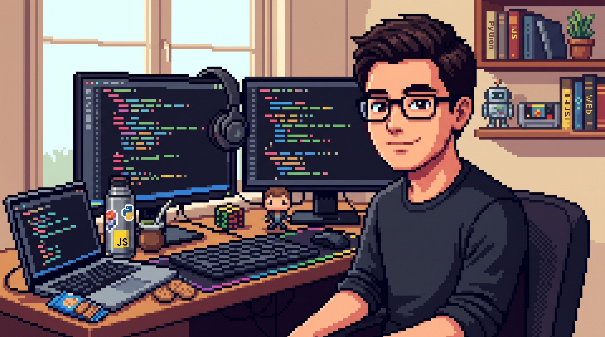

<p align="center">
  
</p>

<h1 align="center">Hola, soy Tomás Abalos 👋</h1>

<p align="center">
  <a href="https://git.io/typing-svg">
    
  </a>
</p>

<p align="center">
  
  
  
</p>

<p align="center">
  <a href="mailto:tomasabalos2@gmail.com"></a>
  <a href="https://www.linkedin.com/in/tomasabalos"></a>
</p>

---

## 🧑‍💻 `whoami`

```python
class Tomas:
    nombre    = "Tomás Abalos"
    roles     = ["Software Developer", "Backend Developer", "Técnico Informático"]
    estudia   = "Ingeniería Informática @ UBA"
    ubicacion = "Buenos Aires, Argentina 🇦🇷"
    idiomas   = {"español": "nativo", "inglés": "conversacional"}
    stack     = ["Python", "TypeScript", "JavaScript", "C++", "SQL", "HTML", "CSS", "Git"]
    busca     = "Trabajo remoto / home office"

    def contactar(self):
        return "tomasabalos2@gmail.com"
```

---

## 🧰 Stack

<table align="center">
  <tr>
    <td align="center"><b>Lenguajes</b></td>
    <td>
      
      
      
      
      
    </td>
  </tr>
  <tr>
    <td align="center"><b>Web</b></td>
    <td>
      
      
    </td>
  </tr>
  <tr>
    <td align="center"><b>Herramientas</b></td>
    <td>
      
      
    </td>
  </tr>
  <tr>
    <td align="center"><b>Metodologías</b></td>
    <td>
      
      
      
    </td>
  </tr>
</table>

---

## 🛤️ Mi recorrido

| | Etapa | Detalle |
|---|---|---|
| 🏫 | **Escuela Técnica N° 2, Mar del Plata** | 7 años de formación técnica y título de Técnico Informático. En 7° año hice mis primeras prácticas profesionales. |
| 💼 | **NextGen IT** · Pasantía (feb–jun 2025) | Desarrollo de Software en una consultora, medio tiempo presencial. |
| 🎓 | **UBA** · En curso | Ingeniería Informática. |
| 📜 | **Universidad Nacional de San Martín** | Certificado en Análisis de Datos y Aprendizaje Automático de IA. |
| 🔐 | **Cisco Networking Academy** | Certificado Introduction to Cybersecurity. |

<details>
<summary><b>💼 ¿Qué hice en mi pasantía en NextGen IT?</b></summary>

<br>

- Codifiqué módulos de software.
- Depuré errores y escribí pruebas unitarias.
- Optimicé procesos y mantuve bases de datos.
- Trabajé con metodologías ágiles y control de versiones.

</details>

<!--
  🚧 SECCIÓN DE PROYECTOS (oculta por ahora)
  Cuando tengas repos listos, borrá este comentario y pegá algo así:

  ## 🚀 Proyectos destacados
  | Proyecto | Descripción | Tecnologías |
  |---|---|---|
  | [Nombre](https://github.com/TU_USUARIO/REPO) | Qué hace, en una línea. | Python |
-->

---

## 🎯 Lo que busco

- 💻 Posiciones de **desarrollo de software / backend** (junior o semi-senior).
- 🏠 Modalidad **remota o híbrida**, en Buenos Aires o para cualquier lugar.
- 🤝 Un equipo donde pueda seguir creciendo y aportar desde el primer día.

> 🇬🇧 *I'm a software developer based in Buenos Aires, open to remote opportunities. I speak conversational English and native Spanish.*

---

## 📈 Actividad en GitHub

<p align="center">
  
  
</p>

<p align="center">
  
</p>

<p align="center">
  
</p>

---

<p align="center">
  ¿Tenés una oportunidad o querés charlar de tecnología?<br>
  Escribime a <a href="mailto:tomasabalos2@gmail.com">tomasabalos2@gmail.com</a> 📫
</p>


